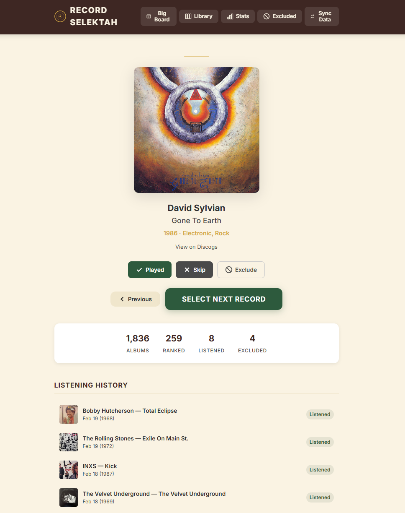

# Public Diplomacy Records

A personal vinyl listening companion that connects to your [Discogs](https://www.discogs.com) collection, randomly selects records for you to listen to, tracks your play history, and optionally integrates with a personal album ranking list (the "Big Board").

Built alongside [Public Diplomacy Records](https://palmaradio.substack.com), a newsletter about building a dream record collection: 30 albums for each year between 1960 and 2020. (The app was originally called Record Selektah, which is why the repository keeps that name.)



## Features

- **Random Selection** -- Pick a record at random from your collection and mark it as Played, Skipped, or Excluded
- **The Library** -- Browse your full Discogs collection sorted by artist, title, or year
- **Listening Stats** -- See your most-played albums ranked by play count
- **Big Board Explorer** -- View your personal album ranking by rank, decade, genre, or track your year-by-year Collecting Progress (defaults to a 1960-2020 / 30-albums-per-year target; adjust `PROGRESS_START_YEAR`, `PROGRESS_END_YEAR`, and `PROGRESS_TARGET_PER_YEAR` near the top of `static/js/app.js` if your Big Board uses a different structure)
- **Excluded Albums** -- Manage albums removed from the random selection pool
- **Album Detail Cards** -- View metadata, genres, styles, play counts, and Discogs links for any album
- **Master Release Overrides** -- Manually set or correct master release links for accurate year data

## Setup

### Prerequisites

- Python 3.12+
- pip
- A [Discogs](https://www.discogs.com) account with a collection

### Installation

1. Clone the repository:

   ```bash
   git clone https://github.com/mprdolo/record-selektah.git
   cd record-selektah
   ```

2. Install dependencies:

   ```bash
   pip install -r requirements.txt
   ```

3. Create a `.env` file from the example:

   ```bash
   cp .env.example .env
   ```

4. Open `.env` and set your Discogs credentials. You'll see a third line, `FLASK_SECRET_KEY` -- that's just an internal Flask setting unrelated to Discogs; leave it as-is or change it to any random string:

   ```
   DISCOGS_TOKEN=your_token_here
   DISCOGS_USERNAME=your_username
   FLASK_SECRET_KEY=change_this_to_a_random_string
   ```

   Generate a personal access token at [discogs.com/settings/developers](https://www.discogs.com/settings/developers).

5. Create a desktop shortcut (Windows):

   ```bash
   python install.py
   ```

   This creates a "Public Diplomacy Records" shortcut on your desktop that launches the app without a console window and opens your browser automatically.

   Alternatively, run the app directly:

   ```bash
   python app.py
   ```

   Then open `http://localhost:3345` in your browser.

## Syncing Your Collection

Click **Sync Data** in the header, then choose **"Sync Discogs Collection"**. This imports every release from your Discogs collection. Re-sync any time to pick up additions or removals.

## Big Board (Optional)

The Big Board is your personal album ranking -- any list of albums ranked by preference.

### CSV Format

Create a CSV file with 4 columns and place it at `data/big_board.csv`. A sample file is included at `data/big_board_sample.csv` to show the expected format -- copy and edit it to get started:

```bash
cp data/big_board_sample.csv data/big_board.csv
```

```csv
Artist,Title,Year,Owned
Radiohead,OK Computer,1997,x
Miles Davis,Kind of Blue,1959,
Talking Heads,Remain in Light,1980,x
```

- Rows are ordered by rank (row 1 = #1, row 2 = #2, etc.)
- Mark `x` in the **Owned** column for albums you own; leave blank otherwise

### Importing

Click **Sync Data** > **"Import Big Board CSV"**. Unmatched entries can be manually linked to your collection in the Big Board Explorer.

Corrections are remembered: if you unlink a wrong match ("I don't own this album") or relink an entry to a different album, re-importing the CSV won't put the wrong match back. Links you make by hand are also kept when an entry moves to a different rank.

### Reordering in the App

On the Big Board's **Rank** tab, drag a record up or down to rerank it, or click its number and type a new rank. **+ Add record** adds a new entry (it's linked to your copy automatically if you own it).

To bring your spreadsheet up to date, click **Copy for Google Sheets**, then click cell **A1** in the sheet and paste. Only columns A–D (Artist, Title, Year, Owned) are replaced, so any formulas to the right are untouched. **Download CSV** saves the same thing as a file.

When you re-import, the app's order wins: entries already on the board stay where you put them, new rows in the spreadsheet are slotted in after the entry they follow there, and rows you deleted from the spreadsheet are removed. Records you added in the app stay until the spreadsheet has them too. If you haven't changed anything in the app since the last import, the spreadsheet's order is used as-is.

## Fetching Master Years (Optional)

Click **Sync Data** > **"Fetch Master Release Years"** to backfill original release years from Discogs master releases. This ensures albums display the original year rather than the year of your specific pressing.

## Usage

| Section | What it does |
|---------|-------------|
| **Home** | Click "Select Next Record" for a random pick. Mark as Played, Skip, or Exclude. |
| **Big Board** | Browse your ranked list by rank tiers, decades, genres, or your year-by-year Collecting Progress. |
| **Library** | Browse your full collection with sort and search. |
| **Stats** | View most-played albums by play count. |
| **Excluded** | Manage albums excluded from random selection. |

## Running the Tests

```bash
pip install -r requirements-dev.txt
python -m pytest
```

The tests use a throwaway database, so they never touch your real data in `data/`.

## Tech Stack

- **Backend:** Flask, SQLite
- **Frontend:** Vanilla JavaScript, HTML, CSS
- **Data Source:** Discogs API

## Credits

Created by [M. Palma](https://palmaradio.substack.com) at Public Diplomacy Records.
